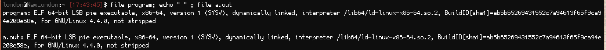
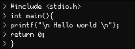
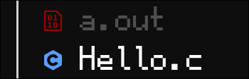
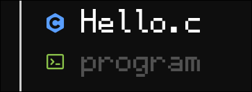
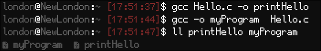

# How to compile code with C

## Gcc
C compiles human code and transforms them into executables that machines can read, there are a few ways to go about compiling. First is Gcc (GNU compiler collection) which is a common compilier used to compile C into executables. Gcc handles the creation of executables in the following steps

| Step | What it does |
| --- | --- |
| Preprocessing | Gcc will parse headers and macros before generating an intermediate source code file |
| Compiling | Source code is converted into assembly for the cpu archtecture |
| Assembly | Assembly is converted into machine code stored in an object file |
| Linking | links library code with object code to make an executable |

- For example, On linux C code is compiled in ELF files which can then be executed via ```./${filename}```

---
<div align="center"></div>

---

We can compile C code in gcc using the following command within our terminal:

Here is some simple code as a baseline:

---
<div align="center"></div>

---

```gcc ${input}```

- Input is where we define all our C files and headers.
Compiling with this method will see our code made into an executable called ```a.out```. Should you not rename this file and compile diffrent code ```a.out``` will simply be over written. There exist better ways for us to make out executables.
---
<div align="center"></div>

---

-O is a flag for which there are many Gcc offers. -O means output and is used to explicitly state we wish to create an exe file. -O must be placed before the name of the output. 

```gcc ${input} -o ${output}```

- Output will be the name of our executable. 

For example:
```gcc hello.c -o print```

---
<div align="center"></div>

---

There is a bit of flexibility one can use when compiling.
Both ```gcc -o ${output} ${input}``` and  ```gcc ${input} -o ${output}``` are valid ways to go about using gcc.

---
<div align="center"></div>

---
